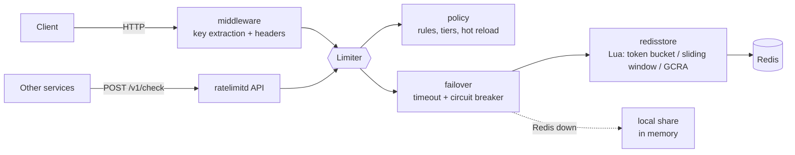
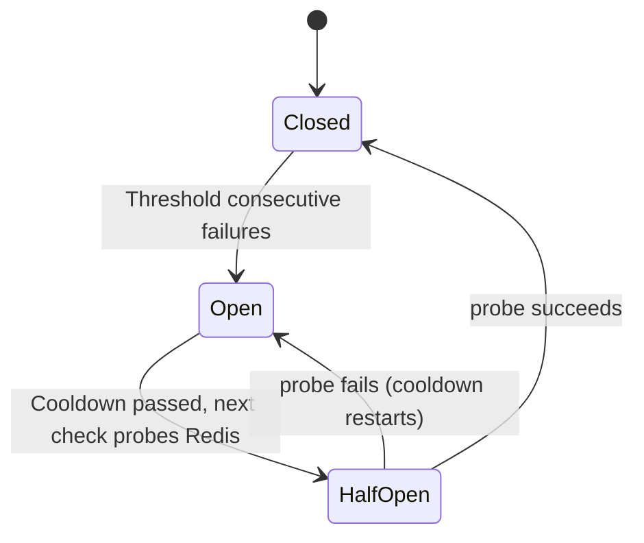

# go-ratelimiter

[](https://github.com/Nguyenngoctruong274/go-ratelimiter/actions/workflows/ci.yml)


[](LICENSE)

A distributed rate limiter in Go. Every instance shares its counters through
Redis, and each check is one atomic Lua script, so ten replicas behind a load
balancer enforce **one** limit, not ten. It can be used as a Go library, as
`net/http` middleware, or as a standalone service that other systems call.

> 🚧 Built in public as a 10-day series. See the [roadmap](#roadmap) for progress.

## Why

A per-process limiter (`golang.org/x/time/rate`) is enough for one box. Once
a service scales out, the limits have to be shared, and that raises the
questions this project answers with code and tests:

- **Atomicity**: read-modify-write of a counter from many instances without
  races. Each algorithm runs as a single Lua script in Redis.
- **Clocks**: instances disagree about the time. The scripts use Redis `TIME`
  as the single clock.
- **Choice of algorithm**: token bucket (bursts), GCRA (the same decisions
  from one timestamp) and sliding window (per-window quotas), with a
  measured [accuracy comparison](#accuracy-comparison). Each has a pure-Go
  reference implementation that the Redis version is tested against.
- **Failure**: when Redis is slow or down, does the caller fail open or
  closed? It has to be a decision, made quickly, not a hung request.
- **Contract**: standard `RateLimit-*` / `Retry-After` headers so clients can
  back off correctly.

## Architecture



| Package | Responsibility |
|---|---|
| `cmd/ratelimitd` | Service wiring (Redis, failover, policies), graceful shutdown |
| `internal/config` | Environment configuration with validation |
| `internal/httpapi` | Probes and `POST /v1/check` |
| `internal/redisstore` | Redis connection; token bucket, GCRA and sliding window as atomic Lua scripts sharing state across instances |
| `internal/limiter` | `Limit`, `Decision`, the `Limiter` interface, `Clock` |
| `internal/algo` | Token bucket, GCRA and sliding window as pure functions of (state, limit, now, cost): the reference for the Lua scripts |
| `internal/memory` | Single-process token-bucket limiter: Redis fallback, or enough for one replica |
| `internal/middleware` | `net/http` middleware: client keys (IP, API key, user), `RateLimit` headers, 429 + `Retry-After` |
| `internal/policy` | JSON rules: route matching, keys, algorithms, tiers, costs; validated and hot-reloaded |
| `internal/breaker` | Circuit breaker: consecutive-failure threshold, cooldown, one half-open probe |
| `internal/failover` | Wraps the Redis limiter with a timeout and a breaker; local fallback or `ErrUnavailable` during an outage |

## Token bucket

A `Limit{Rate, Period, Burst}` allows `Rate` events per `Period` on average
and bursts of up to `Burst` after a quiet period. Each check returns a
`Decision` with `Allowed`, `Remaining`, `RetryAfter` and `ResetAfter`.

```go
lim := memory.New(limiter.SystemClock{})
d, err := lim.Allow(ctx, "user:42", limiter.PerSecond(5, 10), 1)
if !d.Allowed {
    // respond 429 with Retry-After: d.RetryAfter
}
```

How it stays exact:

- **Integer state, no floats.** The level is stored in *token-microseconds*
  (tokens × period in µs). Refilling `Rate` tokens per `Period` then adds
  exactly `Rate` per elapsed microsecond, so a limit of 1/minute or
  100,000/second loses nothing to rounding.
- **Lua-safe range.** `Limit.Validate` keeps `Burst × Period(µs) + Rate`
  below 2^53, the largest range a float64 (Lua's only number type) holds
  exactly. The Redis script therefore produces the same decisions as the Go
  code, and the tests compare them call by call.
- **Denials are free and promises are exact.** A denied request consumes
  nothing, and retrying after `RetryAfter` succeeds, but not one
  microsecond earlier. The fuzz test checks this on every denial.
- **Clock skew can't mint tokens.** If an instance with a lagging clock
  updates a bucket, it does not refill until its clock passes the last
  stamp, and its `RetryAfter` includes that lag.
- **State per (key, limit).** Changing a key's limit starts a fresh bucket
  instead of misreading a level kept in another limit's units.
- **Bounded memory.** Full buckets equal missing ones, so `Sweep` drops them
  and memory tracks keys that were active within one refill period.

`FuzzTokenBucket` drives random limits, costs and clock jumps (including
backwards) and checks that the level stays in `[0, burst]`, that tokens
granted never exceed `burst + rate × elapsed`, that `RetryAfter` and
`ResetAfter` are exact, and that `Remaining` matches the level. It runs
in CI on every push (see below).

| Benchmark (2 vCPU) | ns/op | allocs |
|---|---|---|
| `algo.TokenBucket` (pure step) | 20 | 0 |
| `memory.Allow`, 1,024 keys, serial | 163 | 0 |
| `memory.Allow`, 1,024 keys, parallel | 204 | 0 |

## GCRA

The generic cell rate algorithm is a token bucket described by one number:
the *theoretical arrival time* (TAT), the moment the key is back to its
full burst. A request of cost `n` pushes the TAT `n × Period/Rate` further
out and is granted if that keeps it within `Burst × Period/Rate` of now.

- **Same decisions as the token bucket.** The debt `(TAT − now) × Rate` is
  exactly the bucket's missing level, so on a monotonic clock GCRA and the
  token bucket decide identically. `TestGCRAMatchesTokenBucket` checks it
  call by call over 55 limits and 110,000 calls.
- **Only grants write.** A denial or a peek reads the TAT and changes
  nothing. Under attack, an exhausted key costs Redis no writes, no
  replication and no AOF traffic for the requests it turns away; the token
  bucket rewrites its stamp on every check.
- **Exact fractions.** `Period/Rate` is rarely whole microseconds (3 per
  7ms is 2333⅓µs). Rounding it would admit requests early or late, so the
  TAT is stored as `micros + frac/Rate`, as the string `"<micros>:<frac>"`.
- **Bounded horizon.** The TAT lies up to `Burst × Period/Rate` ahead, so
  `algo.CheckGCRA` caps that at 2^52µs (about 142 years). Unix time in µs
  stays below 2^52 until 2112, keeping the TAT exact in Lua.
- **Skew.** A clock behind the writer's sees more debt, so it can only be
  stricter.

## Sliding window

The sliding-window counter keeps two counts per key instead of a log of
every event. Time is cut into fixed windows of `span = ⌈Burst × Period/Rate⌉`
(the time `Burst` events take at the average rate, so a `Limit` means the
same thing for all three algorithms). The count over the sliding window
ending now is estimated as

```
used = prev × (span − offset) / span + curr
```

and a request is granted if `used + n ≤ Burst`. Everything is computed
multiplied by `span`, in integers, so the estimate is exact; `WindowSpan`
rejects limits where `Burst × span` would pass 2^53.

The model is not exact: it assumes the previous window's events were spread
evenly. When they were bunched at its end, the true count over a sliding
window can exceed `Burst`; when they came early, it denies requests the
exact rule would allow. `RetryAfter` is still exact for the estimate (the
fuzz test checks it to the microsecond), and no fixed window ever holds
more than `Burst`.

## Accuracy comparison

`make compare` replays one minute of traffic through all three algorithms
and an exact sliding log (which remembers every event, so its memory grows
with the burst), all with `PerSecond(10, 10)`, and checks each one against
the rule "at most 10 events in any 1s". Each algorithm is judged on its own
history: **Over** counts grants made although 10 had already been granted in
the last second, **Under** counts denials although there was room.

| Traffic | Algorithm | Allowed | Over | Under | Peak in any 1s |
|---|---|---|---|---|---|
| steady 20/s | sliding log (exact) | 600 | 0 | 0 | 10 |
| | sliding window | 541 | 0 | 648 | 10 |
| | token bucket | 609 | 18 | 0 | 19 |
| | GCRA | 609 | 18 | 0 | 19 |
| 20 requests in the last 100ms of every second | sliding log (exact) | 600 | 0 | 0 | 10 |
| | sliding window | 541 | 0 | 649 | 10 |
| | token bucket | 600 | 0 | 0 | 10 |
| | GCRA | 600 | 0 | 0 | 10 |
| random ~10/s with retry storms | sliding log (exact) | 476 | 0 | 0 | 10 |
| | sliding window | 470 | 42 | 348 | 12 |
| | token bucket | 595 | 284 | 0 | 19 |
| | GCRA | 595 | 284 | 0 | 19 |

What it shows:

- **Token bucket and GCRA are identical** on every request (the test fails
  if they ever differ). They never deny while the average allows it, and
  by design they let up to `2 × Burst` through in one window: a full bucket
  plus a window's worth of refill.
- **The sliding window stays close to the window rule but errs both ways.**
  It mostly under-admits: with steady overload its estimate still counts
  last window's early events after they have left the window, so it allows
  541 where the exact rule allows 600. Under bursty traffic it also
  over-admits, reaching 12 in one second.
- **Choosing.** Use GCRA (or the token bucket) when clients should get a
  burst after a quiet period and the long-run rate is what matters; on
  Redis prefer GCRA, since denials do not write. Use the sliding window
  when the contract is "N per window" (API quotas) and a small error is
  acceptable. A guarantee of "never more than N in any window" needs the
  exact log: a sorted set with one member per event, O(Burst) memory per
  key, which this project leaves out on purpose.

| Benchmark (Apple M2), pure step | ns/op | allocs |
|---|---|---|
| `algo.TokenBucket` | 7.8 | 0 |
| `algo.GCRA` | 8.9 | 0 |
| `algo.SlidingWindow` | 13.8 | 0 |

`FuzzGCRA` and `FuzzSlidingWindow` check the same kind of invariants as
`FuzzTokenBucket` (exact `RetryAfter` and `ResetAfter`, a ceiling on what is
granted, denials leave the state untouched) with backward clock jumps. CI
fuzzes each for 15s; `make fuzz` runs each for a minute.

## On Redis

`redisstore` implements each algorithm as a `limiter.Limiter` with state in
Redis, so every instance that shares the server enforces one limit.

```go
rdb, _ := redisstore.Open(ctx, "redis://localhost:6379/0")
lim := redisstore.NewGCRA(rdb, "")   // or NewTokenBucket, NewSlidingWindow; keys under "rl:"
d, err := lim.Allow(ctx, "user:42", limiter.PerSecond(5, 10), 1)
```

- **One round trip, atomic.** Each check is one `EVALSHA` of a Lua script
  ([`tokenbucket.lua`](internal/redisstore/tokenbucket.lua),
  [`gcra.lua`](internal/redisstore/gcra.lua),
  [`slidingwindow.lua`](internal/redisstore/slidingwindow.lua)), a
  line-by-line port of the Go reference in `algo`. Redis runs a script to
  completion before the next one, so no two instances can spend the same
  token. go-redis falls back to `EVAL` when the script cache is empty
  (restart, failover).
- **One clock.** The scripts read `TIME` on the Redis server, so instances
  with skewed clocks still agree on the state of a key.
- **Exact in Lua.** All values stay below 2^53 and the scripts never format
  numbers with `tostring` (14 significant digits, which would corrupt
  microsecond stamps). Integer division with `math.floor(a / b)` is
  provably exact in that range; the comment in `tokenbucket.lua` has the
  proof and `TestFloat64FloorDivIsExact` checks it on the boundary cases.
  Each algorithm rejects limits that would leave that range
  (`Limit.Validate`, `algo.CheckGCRA`, `algo.WindowSpan`) before calling
  Redis.
- **Self-cleaning.** Keys are `rl:<tb|gcra|sw>:<rate>:<period µs>:<burst>:<key>`.
  Each gets a `PEXPIRE` of exactly the time until the full burst is back,
  and is deleted outright once it is, so idle keys cost nothing and need no
  sweeper.

How it is tested, against a real Redis 7 (CI runs a Redis service). Every
test runs for all three scripts:

| Test | What it proves |
|---|---|
| `TestScriptsMatchReference` | Up to 41 limits (including each algorithm's extremes; each skips the ones it rejects) × 80 random calls with clock jumps both ways: every Lua decision **and** the stored state equal the Go reference |
| `TestScriptsAreAtomicAcrossInstances` | 5 instances (separate pools) × 40 goroutines on one key: exactly `Burst` of 1,000 allowed |
| `TestScriptsUseRedisClockAndExpire` | Waits are measured on the server clock; the key's TTL equals `ResetAfter` |
| `TestScriptsStateExpires` | State disappears once the burst is back, and the key gets its full burst again |
| `TestGCRADenialsDoNotWrite` | An exhausted GCRA key keeps its value and TTL while requests are denied |
| `TestScriptsReloadAfterFlush` | Survives `SCRIPT FLUSH` |
| `TestScriptErrors` | Bad input never reaches Redis; a Redis failure is an error, never a silent allow |

Breaking a script on purpose (saving state with `tostring`, an off-by-one in
a wait, ignoring the clock lag, a `>` for a `>=`) fails the reference test.

All three cost the same: one round trip and about 80 bytes per active key.
Against a local Redis 7 on an Apple M2 laptop, one `Allow` takes about
164 µs serially and 46 µs per call with 8 goroutines, for every algorithm,
which is almost all network round trip. Day 9 works on fewer round trips.

## HTTP middleware

```go
ip, _ := middleware.ByIP(middleware.IPOptions{
    TrustedProxies: []netip.Prefix{netip.MustParsePrefix("10.0.0.0/8")}, // your load balancers
})
limit, err := middleware.New(middleware.Options{
    Limiter: redisstore.NewTokenBucket(rdb, ""),          // or GCRA, SlidingWindow, memory.New
    Limit:   limiter.PerSecond(5, 10),
    Key:     middleware.FirstOf(middleware.ByHeader("X-API-Key"), ip),
    Policy:  "api",
})
http.ListenAndServe(":8080", limit(mux))
```

A runnable version is in [`examples/http-middleware`](examples/http-middleware/main.go).

**Responses.** Every checked request gets the fields of the IETF draft
[RateLimit header fields for HTTP](https://datatracker.ietf.org/doc/draft-ietf-httpapi-ratelimit-headers/):

```http
HTTP/1.1 429 Too Many Requests
RateLimit-Policy: "api";q=5;w=1
RateLimit: "api";r=0;t=2
Retry-After: 1
Content-Type: application/json

{"error":{"code":"rate_limited","message":"rate limit exceeded","retry_after_ms":200}}
```

`q`/`w` are the quota per window, `r` the remaining quota, `t` the seconds
until it is fully restored. `Retry-After` is rounded **up** to whole
seconds so a client that obeys it is never refused for being early;
`retry_after_ms` gives the precise wait. `LegacyHeaders: true` adds the
widely used `X-RateLimit-Limit/-Remaining/-Reset`. For sub-second periods
the advertised quota is scaled to one second and rounded down, so it is
never more generous than the real limit.

**Who is the client?**

| KeyFunc | Key | Notes |
|---|---|---|
| `ByIP` | `ip:203.0.113.7`, `ip:2001:db8:1:2::/64` | IPv6 grouped by /64 (configurable): one subscriber usually owns a whole /64 and could rotate addresses |
| `ByHeader("X-API-Key")` | `h:x-api-key:<sha256 prefix>` | The credential is hashed before it reaches Redis or logs |
| `ByUser(fn)` | `u:<id>` | For ids set by your auth middleware |
| `FirstOf(a, b, …)` | first one found | e.g. API key, else IP |

`X-Forwarded-For` is read **from the right**, and only past hops added by
`TrustedProxies`. The common "take the leftmost address" approach lets any
client pick its own key by sending the header; a test feeds exactly that
spoof and checks it is ignored.

**When things go wrong.**

| Situation | Response |
|---|---|
| Limiter error (Redis down) | `503` with `Retry-After: 1`, or pass through with `FailOpen: true`; see [When Redis fails](#when-redis-fails) for a local fallback |
| Limit out of range for the algorithm | `500`; a config bug is never "failed open" |
| `Cost` above the burst | `400`: no amount of waiting would help |
| No key found | `400` |

Each `Policy` gets its own key namespace, so `search` and `upload` limits
never share state. `TestReplicasShareOneLimitThroughRedis` runs three
replicas of an API, each with its own middleware and connection pool,
behind a simulated load balancer: 90 concurrent requests from one client,
exactly 20 (the burst) pass. With the in-memory limiter the middleware adds
about 1.7 µs per request (`BenchmarkMiddleware`, including the recorder).

## Policies

Instead of one limit in code, a JSON file declares every rule
([full example](internal/policy/testdata/policies.json)):

```json
{
  "policies": [
    {"name": "global", "key": "ip", "limit": {"rate": 600, "period": "1m", "burst": 100}},
    {"name": "login", "match": {"methods": ["POST"], "path": "/v1/login"},
     "key": "ip", "algorithm": "gcra", "limit": {"rate": 5, "period": "1m"}},
    {"name": "api", "match": {"path_prefix": "/v1/"}, "key": "user|header:X-API-Key|ip",
     "limit": {"rate": 60, "period": "1m", "burst": 10},
     "tiers": {"pro": {"limit": {"rate": 1200, "period": "1m", "burst": 200}},
               "internal": {"unlimited": true}}},
    {"name": "export", "match": {"methods": ["POST"], "path": "/v1/exports"}, "key": "user",
     "algorithm": "sliding_window", "cost": 10, "limit": {"rate": 100, "period": "1h"}}
  ]
}
```

```go
store, err := policy.Open("policies.json", policy.Options{
    Limiters: map[string]limiter.Limiter{
        policy.TokenBucket:   redisstore.NewTokenBucket(rdb, ""),
        policy.GCRA:          redisstore.NewGCRA(rdb, ""),
        policy.SlidingWindow: redisstore.NewSlidingWindow(rdb, ""),
    },
    User: userFromContext, // for "user" keys
    Tier: planFromContext, // "free", "pro", ...
}, logger)
go store.Watch(ctx, 5*time.Second)
handler = middleware.Enforce(store, middleware.EnforceOptions{})(mux)
```

**Semantics.**

- Every policy whose `match` fits applies, in file order: a login is
  limited by `global`, `login` and `api`. The request passes only if all
  of them allow it. Checking stops at the first refusal, so later policies
  are not charged for a request that will not be served.
- `key` lists identities to try in order (`user|header:X-API-Key|ip`). A
  policy that cannot identify the client is skipped: `export` only limits
  logged-in users. End with `ip` when anonymous traffic must be limited too.
- A tier replaces the default `limit`; `unlimited` exempts that tier from
  that one policy only. Unknown tiers get the default.
- `cost` charges expensive endpoints more; it must fit in every limit's burst.
- `burst` defaults to `rate`. Headers list each checked policy:
  `RateLimit: "global";r=99;t=1, "login";r=4;t=12`.

**Validation.** Parsing rejects unknown fields (a typo such as `"burts"`
fails instead of silently using a default). Compiling checks each limit
against its algorithm's own bounds, so a limit GCRA or the sliding window
cannot enforce fails at load time, not on the first request. Every problem
is reported at once, with its location:

```text
invalid policies: policies[1] "a".name: duplicate policy name
policies[3] "c".match: path "x" must start with /
policies[4] "d".limit: invalid cost: cost 6 with burst 5
policies[5] "e".tiers.pro: set limit or unlimited, not both
```

**Hot reload.** `Store.Watch` polls the file and compares content hashes
(not modification times, which are coarse on some filesystems and change
when a Kubernetes ConfigMap is re-mounted unchanged). A valid new file is
compiled into an immutable set and swapped in atomically, so a request
never sees half of the old rules and half of the new. An invalid edit is
rejected as a whole and logged; the last good rules stay in force, because
a typo in production must not remove every limit. A test resolves from
four goroutines while the file changes under the race detector.

Changing a rule's limit starts its clients with fresh state: state is kept
per (key, limit), so a level measured against the old limit is never
misread under the new one.

## When Redis fails

Every instance depends on Redis for every decision, so an outage has to be
planned for. `failover` wraps the Redis limiter:

```go
local := memory.New(limiter.SystemClock{}) // run local.Sweep() periodically
lim, err := failover.New(redisstore.NewGCRA(rdb, ""), failover.Options{
    Fallback: local,                  // nil: return failover.ErrUnavailable
    Replicas: 4,                      // instances sharing this Redis
    Timeout:  50 * time.Millisecond,  // a slow check counts as a failure
    Breaker:  breaker.Options{Threshold: 5, Cooldown: 5 * time.Second},
})
```



- **Fast failure.** A check gets at most `Timeout` on Redis. After
  `Threshold` consecutive failures the breaker opens and checks stop going
  to Redis at all, so a dead Redis costs microseconds per request instead of
  a dial timeout, and a struggling one is not hammered while it recovers.
- **One probe.** After `Cooldown` a single check probes Redis; every other
  check keeps using the fallback until it answers. A failed probe restarts
  the cooldown.
- **Three behaviors, one choice.** With no fallback the limiter returns
  `ErrUnavailable` and the middleware **fails closed** (503) or, with
  `FailOpen`, **fails open** for that policy. With a fallback it decides
  **locally**: each instance enforces `1/Replicas` of every limit (rate and
  burst rounded up, the burst never below a valid cost), so the fleet as a
  whole grants about one limit, not `Replicas` of them. `TestMiddlewareWithRedisDown`
  shows the three side by side.
- **Only real failures count.** An invalid limit or cost is a bug, not an
  outage, and a check the caller's context canceled says nothing about
  Redis: neither trips the breaker. Results from calls that started before
  the breaker changed state are discarded, so a slow success from before
  an outage cannot close it.
- **What is lost.** Local decisions use the token bucket whatever the
  policy's algorithm, and assume traffic is spread evenly across instances.
  Grants made locally are not written to Redis, so after recovery a client
  may get up to one extra local share. State changes are logged
  (`rate limiter breaker changed state`, `warn` when it opens).

`TestRedisOutageAndRecovery` runs this against a real Redis behind a TCP
proxy the test cuts and restores: during the cut every decision comes from
the local share (2 of 10 with 5 replicas), and once Redis is back a probe
closes the breaker and decisions continue from the state Redis kept.

## Service mode

Services that cannot embed the Go middleware (other languages, an API
gateway) ask `ratelimitd` for a decision over HTTP. They name a policy
from the server's file and identify the client:

```bash
curl -s -XPOST localhost:8080/v1/check \
  -d '{"policy": "login", "key": "ip:203.0.113.7"}'
```

```json
{"allowed":true,"policy":"login","limit":{"rate":5,"period_ms":60000,"burst":5},
 "remaining":4,"retry_after_ms":0,"reset_after_ms":12000}
```

| Field | |
|---|---|
| `policy` | Required. A policy name from `RL_POLICY_FILE` |
| `key` | Required, 1–256 bytes. The client, as the caller identifies it |
| `tier` | Optional. Picks the tier's limit; an `unlimited` tier answers `{"allowed":true,"unlimited":true}` |
| `cost` | Optional. Defaults to the policy's `cost`; `0` reads the state without consuming |

- **Callers cannot choose limits.** The request names a policy; the limit
  lives in the server's file. A compromised or buggy caller can spend a
  client's quota but never raise it.
- **A denial is a `200`.** The check succeeded and the answer is "no":
  `allowed:false` with `retry_after_ms` (rounded up). Status codes are
  kept for failures of the check itself: `400` bad body or cost, `404`
  unknown policy, `500` a limit the algorithm cannot enforce, `503` Redis
  unavailable (or `allowed:true, fail_open:true` with
  `RL_ON_REDIS_FAILURE=open`).
- **One state with the middleware.** Keys are namespaced as
  `<policy>:<key>`, exactly as the middleware does, so a Go service using
  the middleware and a gateway calling `/v1/check` with the same policy
  and key draw from the same quota.
- **Readiness.** Only a fail-closed instance reports not-ready when Redis
  is down. In `open` or `local` mode it can still answer, and failing
  readiness would make the load balancer drop every instance at once.

Every Redis limiter is wrapped in `failover` (see [When Redis fails](#when-redis-fails))
with the `RL_ON_REDIS_FAILURE`, `RL_REPLICAS`, `RL_REDIS_TIMEOUT` and
`RL_BREAKER_*` settings, and the policy file is reloaded every
`RL_POLICY_RELOAD`.

**Multi-instance tests** (`cmd/ratelimitd`, against a real Redis) start
three fully wired instances, each with its own connection pool, from the
same config:

| Test | What it proves |
|---|---|
| `TestInstancesEnforceOneLimit` | 240 concurrent checks for one client spread over 3 instances, for each algorithm: exactly `Burst` (25) allowed, and the grants report remaining counts 24…0 once each, so every check saw the state the previous one left |
| `TestInstancesShareStateSequentially` | Alternating instances continue one count; an unlimited tier is never counted |
| `TestPolicyReloadReachesEveryInstance` | Editing the shared file changes the limit on every instance |

## Quick start

```bash
make up          # Redis in Docker
make run         # ratelimitd on :8080 with deploy/policies.json
curl localhost:8080/healthz   # {"status":"ok"}
curl -XPOST localhost:8080/v1/check -d '{"policy":"api","key":"demo"}'
curl localhost:8080/readyz    # {"status":"ready"}; 503 if Redis is down in closed mode
make test-redis  # unit tests + tests against the real Redis
```

Or run everything in containers: `make stack`.

## Configuration

| Variable | Default | Description |
|---|---|---|
| `RL_REDIS_URL` | required | `redis://` or `rediss://` URL of the shared Redis |
| `RL_HTTP_ADDR` | `:8080` | Listen address |
| `RL_LOG_LEVEL` | `info` | `debug`, `info`, `warn`, `error` |
| `RL_SHUTDOWN_TIMEOUT` | `15s` | Maximum time to finish in-flight requests |
| `RL_SHUTDOWN_DRAIN` | `0` | Time `/readyz` reports 503 before the listener closes |
| `RL_POLICY_FILE` | required | JSON policy file served by `/v1/check` (`deploy/policies.json` with `make run`) |
| `RL_POLICY_RELOAD` | `5s` | How often the policy file is checked for changes; `0` disables |
| `RL_ON_REDIS_FAILURE` | `closed` | `closed` (503), `open` (allow) or `local` (in-memory share of each limit) |
| `RL_REPLICAS` | `1` | Instances sharing Redis; in `local` mode each enforces `1/RL_REPLICAS` of a limit |
| `RL_REDIS_TIMEOUT` | `100ms` | Longest a check waits for Redis before it counts as a failure |
| `RL_BREAKER_THRESHOLD` | `5` | Consecutive Redis failures that open the circuit breaker |
| `RL_BREAKER_COOLDOWN` | `5s` | How long the breaker stays open before probing Redis |

Invalid configuration is reported all at once at startup. Redis timeouts are
deliberately short (dial 2s, read/write 500ms): a limiter sits on the hot
path of its callers, so a slow Redis must become a fast error.

## Probes and shutdown

- `GET /healthz`: liveness. Does **not** touch Redis, so a Redis blip does not
  restart every pod.
- `GET /readyz`: readiness. Returns 503 while draining, and pings Redis
  when `RL_ON_REDIS_FAILURE=closed`.
- On `SIGTERM`: readiness turns 503, the service waits `RL_SHUTDOWN_DRAIN`,
  then shuts the HTTP server down within `RL_SHUTDOWN_TIMEOUT`.

## Roadmap

- [x] **Day 1**: Scaffold: config, probes, slog, graceful shutdown, Docker, compose with Redis, CI
- [x] **Day 2**: Token bucket, in-memory, with a fake clock, table tests and fuzzing
- [x] **Day 3**: Token bucket on Redis via Lua; equivalence tests against the Go version on real Redis
- [x] **Day 4**: Sliding window and GCRA (Redis + Go); accuracy comparison
- [x] **Day 5**: HTTP middleware: key extraction (IP, header, user), `RateLimit-*` headers, `Retry-After`
- [x] **Day 6**: Policy engine: multiple rules, tiers, file-based config with hot reload
- [x] **Day 7**: Failure handling: fail-open / fail-closed, circuit breaker, local fallback
- [x] **Day 8**: Service mode: `POST /v1/check`; multi-instance integration tests on shared Redis
- [ ] **Day 9**: Metrics, benchmarks (checks/s, p99), fewer round trips with pipelining
- [ ] **Day 10**: Final README, design decisions, v1.0.0

## Notes

- Policy files are JSON rather than YAML: the YAML libraries live on
  `gopkg.in`, which the build environment of this project cannot fetch.
- Only HTTP is in scope. A gRPC interceptor would need `google.golang.org/grpc`,
  which the build environment of this project cannot fetch.

## License

[MIT](LICENSE)
