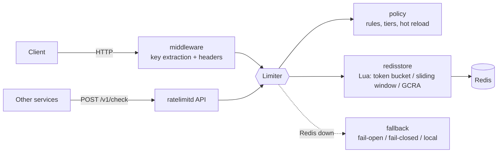

# go-ratelimiter

[](https://github.com/Nguyenngoctruong274/go-ratelimiter/actions/workflows/ci.yml)


[](LICENSE)

A distributed rate limiter in Go. Every instance shares its counters through
Redis, and each check is one atomic Lua script, so ten replicas behind a load
balancer enforce **one** limit, not ten. It can be used as a Go library, as
`net/http` middleware, or as a standalone service that other systems call.

> 🚧 Built in public as a 10-day series. See the [roadmap](#roadmap) for progress.

## Why

A per-process limiter (`golang.org/x/time/rate`) is enough for one box. Once
a service scales out, the limits have to be shared, and that raises the
questions this project answers with code and tests:

- **Atomicity**: read-modify-write of a counter from many instances without
  races. Each algorithm runs as a single Lua script in Redis.
- **Clocks**: instances disagree about the time. The scripts use Redis `TIME`
  as the single clock.
- **Choice of algorithm**: token bucket (bursts), sliding window (strict),
  and GCRA (one key, smooth). Each has a pure-Go reference implementation
  that the Redis version is tested against.
- **Failure**: when Redis is slow or down, does the caller fail open or
  closed? It has to be a decision, made quickly, not a hung request.
- **Contract**: standard `RateLimit-*` / `Retry-After` headers so clients can
  back off correctly.

## Architecture



| Package | Responsibility |
|---|---|
| `cmd/ratelimitd` | Service wiring, graceful shutdown |
| `internal/config` | Environment configuration with validation |
| `internal/httpapi` | Probes now; check and policy endpoints later |
| `internal/redisstore` | Redis connection; Lua limiter scripts (day 3+) |
| `internal/limiter` | `Limiter` interface and `Decision` (day 2) |
| `internal/algo` | Pure-Go reference algorithms (day 2–4) |
| `internal/middleware` | `net/http` middleware (day 5) |
| `internal/policy` | Rules and tiers with hot reload (day 6) |

## Quick start

```bash
make up          # Redis in Docker
make run         # ratelimitd on :8080
curl localhost:8080/healthz   # {"status":"ok"}
curl localhost:8080/readyz    # {"status":"ready"}, 503 if Redis is unreachable
make test-redis  # unit tests + tests against the real Redis
```

Or run everything in containers: `make stack`.

## Configuration

| Variable | Default | Description |
|---|---|---|
| `RL_REDIS_URL` | required | `redis://` or `rediss://` URL of the shared Redis |
| `RL_HTTP_ADDR` | `:8080` | Listen address |
| `RL_LOG_LEVEL` | `info` | `debug`, `info`, `warn`, `error` |
| `RL_SHUTDOWN_TIMEOUT` | `15s` | Maximum time to finish in-flight requests |
| `RL_SHUTDOWN_DRAIN` | `0` | Time `/readyz` reports 503 before the listener closes |

Invalid configuration is reported all at once at startup. Redis timeouts are
deliberately short (dial 2s, read/write 500ms): a limiter sits on the hot
path of its callers, so a slow Redis must become a fast error.

## Probes and shutdown

- `GET /healthz`: liveness. Does **not** touch Redis, so a Redis blip does not
  restart every pod.
- `GET /readyz`: readiness. Pings Redis and returns 503 while draining.
- On `SIGTERM`: readiness turns 503, the service waits `RL_SHUTDOWN_DRAIN`,
  then shuts the HTTP server down within `RL_SHUTDOWN_TIMEOUT`.

## Roadmap

- [x] **Day 1**: Scaffold: config, probes, slog, graceful shutdown, Docker, compose with Redis, CI
- [ ] **Day 2**: Token bucket, in-memory, with a fake clock, table tests and fuzzing
- [ ] **Day 3**: Token bucket on Redis via Lua; equivalence tests against the Go version on real Redis
- [ ] **Day 4**: Sliding window and GCRA (Redis + Go); accuracy comparison
- [ ] **Day 5**: HTTP middleware: key extraction (IP, header, user), `RateLimit-*` headers, `Retry-After`
- [ ] **Day 6**: Policy engine: multiple rules, tiers, file-based config with hot reload
- [ ] **Day 7**: Failure handling: fail-open / fail-closed, circuit breaker, local fallback
- [ ] **Day 8**: Service mode: `POST /v1/check`; multi-instance integration tests on shared Redis
- [ ] **Day 9**: Metrics, benchmarks (checks/s, p99), fewer round trips with pipelining
- [ ] **Day 10**: Final README, design decisions, v1.0.0

## Notes

- Only HTTP is in scope. A gRPC interceptor would need `google.golang.org/grpc`,
  which the build environment of this project cannot fetch.

## License

[MIT](LICENSE)
